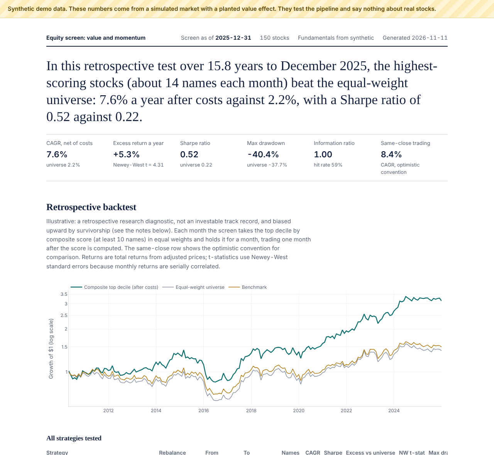

# Quantitative Equity Research & Valuation Platform

A quantitative stock screen for the S&P 500. It pulls prices and company financials from
free sources, computes valuation multiples and factor scores, ranks stocks to decide
which deserve fundamental research first, and tests whether the ranking would have
picked outperformers, using only figures that were public, in the version that was
public, at each point in time.

Stocks are scored only in months they were S&P 500 members (membership rebuilt from
Wikipedia's dated change history), but companies that left the index are mostly missing
from free price data, so backtest returns still carry **survivorship bias** (see
[Limitations](#limitations)). **Backtest results are illustrative, not definitive**: a
retrospective research diagnostic, not evidence of investable performance.

**What it covers**

- **Financial statement analysis:** P/E, P/B, EV/EBITDA, EV/EBIT and PEG, built from
  income statements and balance sheets, with split handling and versioned filings
  (originals, 10-K/A amendments and restatements each used only from their filing date).
- **Factor model:** value (earnings yield, EBIT/EV, EBITDA/EV, book/market) and 12-1
  momentum, winsorized, sector-neutral z-scores combined into a composite. Plus a
  rule-based baseline: cheapest EV/EBIT among stocks with positive momentum.
- **Validation:** top-decile backtests net of costs (CAGR, Sharpe, information ratio,
  drawdown, Newey-West t-statistics) against the equal-weight universe and SPY, with a
  one-month execution delay as a robustness check; decile spreads and rank ICs at 1, 6
  and 12 months.
- **Intrinsic value and earnings quality:** a five-year FCFF discounted cash flow model
  with a WACC build, equity bridge, bear/base/bull scenarios and a WACC × terminal-growth
  sensitivity grid, driven by your stated assumptions and the company's point-in-time
  filings; accruals ratio, cash conversion and free-cash-flow trends for every stock.
- **Analyst-ready research report** for one company: fundamentals, peer multiples, DCF
  scenarios, earnings quality, factor rankings, price risk, key risks, source filings with
  EDGAR links, assumptions and limitations.
- **Real-market validation:** filing-availability checks, survivorship disclosure, real vs
  synthetic comparison, and an archive of the exact inputs behind a result.
- **Stretch goal:** logistic and ridge models with purged time-series cross-validation,
  compared out of sample against the fixed-weight composite; PCA on the factors.
- **Engineering:** SQLite with a point-in-time SQL join, cached downloads with every HTTP request logged,
  data quality checks that stop bad runs, a monthly scheduler for Windows and an
  Airflow DAG, an offline test suite plus live checks on real corporate actions.

> **Not investment advice.** Labels (Research candidate / Neutral / Lower priority) are
> mechanical screening classifications that decide where to look first. They are not
> ratings, recommendations or price targets.

## Requirements

- **Python 3.10 or newer.** Last verified with Python 3.12 on Linux; exact package versions
  are pinned in `requirements-tested.txt` (`requirements.txt` has the minimums).
- Internet access for live runs. The demo and the offline tests need none.
- Optional, for PDF reports: `pip install -e ".[pdf]"` then `python -m playwright install chromium`.
  Without it, reports are still written as self-contained HTML that prints to PDF from any browser.
- Optional: Docker, for a containerized environment (see [Docker](#docker)).

**Credentials and environment variables.** None are needed for the default yfinance source
or for SEC EDGAR. Put API keys in `.env` (created from `.env.example` by `setup.ps1`; never
committed).

| Variable or setting | Needed when | Where |
|---|---|---|
| `fundamentals.sec_user_agent` | `fundamentals.source: sec` | `config/config.yaml`. SEC needs no token but requires a User-Agent with your name and email |
| `FMP_API_KEY` | `fundamentals.source: fmp` | `.env` |
| `ALPHAVANTAGE_API_KEY` | `fundamentals.source: alphavantage` | `.env` |
| `EQSCREEN_LIVE=1` | running `tests/test_live.py` | shell |
| `EQSCREEN_LIVE_SOURCE`, `SEC_USER_AGENT` | choosing the source for live tests (SEC needs the agent) | shell |

**Reproducibility.** Every run writes a `manifest` into `outputs/run_summary.json`: Python and
package versions, a hash of the configuration, row counts and date ranges of the price and
statement data, and the window of fetch timestamps. Raw data are cached in `data_raw/` and
can't be redistributed, so a published result is reproduced by rerunning with the same
configuration; the manifest shows whether the inputs matched. The demo is fully
reproducible: it is generated from a fixed seed.

## Quickstart (Windows, PowerShell)

```powershell
git clone <your-repo-url> equity-screener      # TODO: replace with the published GitHub URL
cd equity-screener
powershell -ExecutionPolicy Bypass -File scripts\setup.ps1
```

`setup.ps1` creates `.venv`, installs the package, creates `.env` from `.env.example`,
and runs the offline demo. Open `outputs\demo_synthetic\report.html` to check the
install. It should look like this (synthetic data, labelled as such on the page):



That screenshot shows the report layout, not evidence of performance. **The demo uses a synthetic market with a planted value effect**: its numbers
test the pipeline and say nothing about real stocks.

Then run it on real data:

```powershell
.\.venv\Scripts\Activate.ps1
python -m eqscreen.pipeline --mode live
```

Results land in `outputs\` (see [Outputs](#outputs)). A first run on the full S&P 500
takes a while because every ticker's statements are downloaded; later runs reuse the
cache. For a quick first try, set `universe.source: file` in `config/config.yaml` to
use the 30-stock `data_raw/sample_universe.csv` and lower `factors.min_names_per_date`
to about 15. **Treat that as a smoke test only:** a top decile of 30 stocks is 3 names,
so the backtest holds the top 10 instead, and results swing on individual stocks. The
`universe_breadth` check flags this. Use the full S&P 500 for any conclusions.

<details><summary>macOS / Linux</summary>

```bash
python -m venv .venv && source .venv/bin/activate
pip install -e ".[dev]"
cp .env.example .env
python -m eqscreen.pipeline --mode demo
python -m eqscreen.pipeline --mode live
```
</details>

## Choosing a fundamentals source

Set `fundamentals.source` in `config/config.yaml`.

| Source | Key needed | Real filing dates | Best for |
|---|---|---|---|
| `yfinance` (default) | No | No (fiscal year-end + 90 days) | Getting started; only a few years of statements |
| `sec` | No, but set `sec_user_agent` to your name and email | Yes | Longest point-in-time history; recommended for backtests |
| `fmp` | `FMP_API_KEY` in `.env` | Yes | Clean statements; free tier is limited |
| `alphavantage` | `ALPHAVANTAGE_API_KEY` in `.env` | No | Small universes; set `max_requests_per_run` for the free tier |

Prices always come from yfinance. Provider limits change, so check each provider's
current terms. Details: [docs/methodology.md](docs/methodology.md#data-sources-and-their-limits).

## Running stages

```powershell
python -m eqscreen.pipeline --mode live                        # everything
python -m eqscreen.pipeline --mode live --from-stage quality   # recompute without refetching
python -m eqscreen.pipeline --mode live --stages prices,fundamentals
```

Stages: `universe`, `prices`, `fundamentals`, `quality`, `factors`, `screen`,
`backtest`, `model`, `report` (demo mode replaces the first three with `synthetic`).
The console shows one line per stage and a short results summary at the end; add
`--verbose` (or set `logging.console: verbose`) for the full log on screen. Each run is
recorded in the `pipeline_runs` table and `logs/pipeline.log`. The
`fetch_log` table records, with UTC timestamps: every HTTP request and retry this code
makes to FMP, Alpha Vantage, SEC and Wikipedia (endpoint, HTTP status, attempt; API keys
are never logged), plus one outcome row per ticker (ok, cached, empty, error,
rate-limited, skipped). yfinance makes its own requests inside the library, so those
are logged per ticker only.

## Real-company case study: the full workflow

```powershell
# 1. Live run on SEC filings (set fundamentals.source: sec and sec_user_agent in config.yaml)
python -m eqscreen.pipeline --mode live

# 2. Validate the real data and preserve the inputs
python -m eqscreen.validate --archive          # outputs\validation\validation_report.md
python -m pytest tests\test_live.py -v         # with $env:EQSCREEN_LIVE = "1"

# 3. DCF: write the template, fill in assumptions (with sources), value
python -m eqscreen.dcf --ticker MSFT --init
python -m eqscreen.dcf --ticker MSFT

# 4. Key risks: write the template, fill it in from the 10-K risk factors (cite them),
#    and sign off with "Reviewed by: Your Name, YYYY-MM-DD"
python -m eqscreen.research --ticker MSFT --init-risks

# 5. The report (Markdown and self-contained HTML; --pdf adds a PDF)
python -m eqscreen.research --ticker MSFT --pdf # outputs\research\MSFT_<yyyymm>.md/.html/.pdf
```

The research report combines financial fundamentals (multi-year, each year as published by
the report date), the nearest-market-cap sector peers' multiples, DCF bear/base/bull values,
the earnings-quality history and flags, factor rankings within the universe and the sector,
36-month price risk, your key-risks text plus mechanical flags from the data, the source
filings with EDGAR links, the DCF assumptions with their recorded sources, and the model
limitations. Everything is as of one month: the DCF is only included when its assumptions
file is for the same company and dated to the report month, and analyst work written well
after that month is labelled retrospective. It is marked DRAFT until the key-risks file has real text
and a dated "Reviewed by" sign-off. Commit the report, the assumptions file and the risks
file together.

## DCF valuation for one company

```powershell
python -m eqscreen.dcf --ticker AAPL --init     # writes config\dcf\AAPL.yaml
# fill in every blank forward-looking assumption in that file, then:
python -m eqscreen.dcf --ticker AAPL            # writes outputs\dcf\AAPL_<yyyymm>.md and CSVs
```

Add `scenarios` (bear, bull: any assumptions to override) and optional `scenario_weights`
to get a scenario table and a probability-weighted value. The base year (revenue, EBIT,
D&A, capex, debt, cash, diluted shares, price, 60-month beta)
comes from the pipeline, exactly as known at the valuation month. Growth, margins, tax,
reinvestment, terminal growth, risk-free rate, equity risk premium and cost of debt are your
judgments: `--init` fills in the company's recent history for reference and leaves those
blank, and the model refuses to run until they are set. Output: assumptions next to history,
WACC build, five-year FCFF forecast, EV-to-equity bridge, value per share against the price,
a WACC × terminal-growth sensitivity table, and a reverse DCF: the terminal growth, or the
constant revenue growth, that the current share price implies with everything else held fixed.
Terminal growth at or above WACC is refused, and a note appears when it exceeds the risk-free rate. Method and sourcing guidance:
[docs/dcf.md](docs/dcf.md).

## Analyst note for one stock

```powershell
python -m eqscreen.note --ticker AAPL                # latest scored month
python -m eqscreen.note --ticker AAPL --as-of 2023-06
```

Writes `outputs\notes\AAPL_latest.md`: screen rank and label, valuation against sector
and universe medians, the financial profile from the exact statement version the screen
used that month, screen history, 36-month price risk, and the filings behind the numbers
(with EDGAR links when the source is `sec`). Every figure comes from your own run.

## Docker

```powershell
docker build -t eqscreen .
docker run --rm -v "${PWD}/outputs:/app/outputs" eqscreen                       # offline demo
docker run --rm --env-file .env -v "${PWD}/data:/app/data" -v "${PWD}/data_raw:/app/data_raw" `
    -v "${PWD}/outputs:/app/outputs" -v "${PWD}/logs:/app/logs" eqscreen --mode live
docker run --rm --entrypoint python eqscreen -m pytest                          # test suite
docker run --rm -v "${PWD}/outputs:/app/outputs" --entrypoint python eqscreen -m eqscreen.research --ticker MSFT
```

The image pins the package versions in `requirements-tested.txt`. Data, downloads, outputs and
logs are mounted from the host so they survive the container. To use your own configuration or
DCF and risks files, also mount `config`: `-v "${PWD}/config:/app/config"`. PDF output is not
installed in the image; use the HTML reports.

## Scheduling the monthly refresh

**Windows Task Scheduler** (runs at 06:00 on the 2nd of each month by default, after
the previous month-end close):

```powershell
powershell -ExecutionPolicy Bypass -File scripts\register_monthly_task.ps1 -Day 2 -Time 06:00
Start-ScheduledTask -TaskName EquityScreenerMonthly                  # test it now
Unregister-ScheduledTask -TaskName EquityScreenerMonthly -Confirm:$false   # remove
```

Each scheduled run writes `logs\scheduled_<timestamp>.log`. A failed quality check
stops the run with a non-zero exit code, which Task Scheduler shows as the last result.

**Airflow:** `dags/equity_screener_dag.py` defines the same monthly schedule with one
task per stage and retries. Airflow needs WSL2 or Docker on Windows, and a
single-machine executor because the database is a local SQLite file.

## Outputs

| File | Contents |
|---|---|
| `report.html` | The dashboard: headline result, growth chart, decile and IC charts, P/E vs forward return, factor correlations, current screens, model check, quality checks |
| `screen_composite_latest.csv` | Every scored stock, ranked, with multiples, factor scores and label; also saved as `screen_composite_YYYYMM.csv` (keep these: they become your out-of-sample record) |
| `screen_rule_based_latest.csv` | Rule-based baseline, top 50 |
| `backtest_summary.csv` | Performance statistics per strategy and holding period |
| `backtest_monthly.csv` | Monthly returns, turnover and holdings count |
| `decile_returns.csv`, `ic_summary.csv`, `ic_timeseries.csv` | Factor-to-return diagnostics |
| `model_cv.csv`, `model_coefficients.csv`, `pca_*.csv` | Model check |
| `ev_coverage.csv` | Per month: stocks with both debt and cash reported (eligible for EV factors) and how many lacked each |
| `notes\<TICKER>_*.md`, `dcf\<TICKER>_*.md`, `research\<TICKER>_*.md` | Analyst note, DCF valuation and research report, when you run those commands |
| `validation\validation_report.md`, `real_vs_synthetic.csv`, `filing_lags.csv` | Real-market validation (`python -m eqscreen.validate`) |
| `quality_checks.csv`, `run_summary.json` | Run metadata |
| `charts/*.png` | Static charts, including `pe_vs_forward_return.png` |

The report loads plotly.js from a CDN; set `report.inline_plotlyjs: true` for a
self-contained file that works offline (about 4.5 MB larger).

## Method in brief

1. **Point in time.** Each month-end uses the latest version of each statement filed
   by then: originals until an amendment or restatement is filed, the revision after.
   Real filing dates where available, otherwise fiscal year-end + 90 days. Tests prove
   that deleting all future data, or adding a later amendment, leaves past scores
   unchanged.
2. **Split adjustment.** Filings report shares in pre-split units while Yahoo prices are
   split-adjusted; shares and EPS are restated so market caps are right.
3. **Scoring.** Winsorize, z-score and sector-neutralize each factor per month; average
   the value measures; combine 50/50 with momentum.
4. **Backtest (a retrospective research diagnostic).** Buy the top decile in equal
   weight one month after the signal, hold 1, 6 or 12 months, charge 10 bps per unit
   traded, compare with the equal-weight universe and SPY. Also report same-close
   trading, a worst case for missing returns, and Newey-West t-statistics. Returns run on an
   unbroken monthly calendar: a month without a usable signal carries the holdings instead
   of disappearing from the series.
5. **Model check.** Time-series CV split by date with a 12-month purge gap, so no
   training label overlaps a test month.

Full definitions: [docs/factors.md](docs/factors.md). Pipeline, validation, quality
checks and limitations: [docs/methodology.md](docs/methodology.md).

## Limitations

- **Survivorship bias:** stocks are scored only while they were index members (membership
  rebuilt from Wikipedia's change history, which is incomplete for early years), so the
  screen can't buy a company before it joined. But companies that left the index are
  mostly absent from free price data, so their (often poor) returns are missing and results
  are biased upward. `validate` reports how many departures are missing. A full fix needs
  survivorship-free constituent and delisting data.
- **Restatements before your first download** are baked into yfinance, FMP and Alpha
  Vantage figures; only `sec` reconstructs filing-time values. Later changes are
  versioned automatically.
- **Monthly execution model:** the headline trades one month after the signal; the
  same-close result (`composite_lag0`) is shown as the optimistic convention. A daily,
  next-session execution model would sit between the two.
- **Missing returns** count as cash; `composite_missing_loss` shows the worst case
  (every missing month a total loss) and the report gives the share of holding-months
  affected.
- **Model comparison on observable outcomes:** the machine-learning check (and its same-cohort
  composite) can only use stock-months whose 12-month future return is known, which quietly
  favors survivors; compare those two with each other, never with the main backtest.
- **Not live-tradable performance:** monthly execution conventions, flat costs, missing-return
  assumptions and the points above mean no result here should be presented as returns an
  investor could have earned.
- **Short history** with yfinance; use `sec` for longer backtests.
- Annual statements only, simplified EV, flat transaction costs.

## Continuous integration

`.github/workflows/ci.yml` runs on every push: the full offline test suite and the synthetic
demo on Linux with Python 3.12 and the pinned versions, plus a Docker build that runs the
demo and the tests inside the container. Demo outputs (synthetic) are attached to each run.

## Testing and what each kind of evidence shows

```powershell
python -m pytest                                   # offline suite (live checks skip)

$env:EQSCREEN_LIVE = "1"                           # live checks on real data
$env:EQSCREEN_LIVE_SOURCE = "sec"                  # or yfinance / fmp / alphavantage
$env:SEC_USER_AGENT = "Your Name you@example.com"
python -m pytest tests/test_live.py -v
```

| Evidence | Establishes | Does not establish |
|---|---|---|
| Offline unit tests | Parsers, point-in-time joins, amendment handling, split adjustment, backtest arithmetic, purged CV folds and quality checks behave as specified | That real provider data match the fixtures |
| Synthetic planted-signal test | The pipeline recovers a known effect (value) and invents none (momentum, shuffled scores) | That these factors predict real returns |
| Live checks | Real data parse; split handling holds on AAPL, TSLA and NVDA splits; tells you if a provider needs `split_adjust: false` | Anything about returns |
| Saved real SEC fixture (`tests/test_real_fixture.py`) | On real filings: originals and later restatements are separate dated versions with valid accession links, and shares are continuous across a documented split | Anything about returns; Yahoo prices are not saved |
| Historical run on real data | How the method performed on this universe and period, under stated assumptions | Future performance (and survivorship bias inflates it) |
| Saved monthly screens over time | True out-of-sample results | Available only after months of tracking |

Run the live checks once per data source before trusting a live backtest. To keep real-data
evidence in the repo, capture SEC fixtures once (SEC data, not Yahoo's, can be saved):

```powershell
python scripts\capture_sec_fixture.py --ticker AAPL --user-agent "Your Name you@example.com"
python scripts\capture_sec_fixture.py --ticker NVDA --user-agent "Your Name you@example.com"
python -m pytest tests\test_real_fixture.py -v
```

## Repository layout

```
equity-screener/
├── config/config.yaml          all settings: universe, sources, factor weights, backtest, checks
├── config/dcf/                 your DCF assumption files, one per company
├── config/research/            your key-risks files, one per company
├── sql/
│   ├── schema.sql              SQLite tables
│   └── factor_inputs.sql       point-in-time join of prices to fundamentals
├── src/eqscreen/
│   ├── pipeline.py             CLI and stage orchestration
│   ├── universe.py             S&P 500 from Wikipedia, or a CSV
│   ├── prices.py               yfinance month-end prices and splits
│   ├── fundamentals.py         yfinance / FMP / Alpha Vantage / SEC parsers, cache, fetch log
│   ├── quality.py              data quality checks
│   ├── factors.py              ratios, split adjustment, z-scores, composite, labels
│   ├── screen.py               ranked screens
│   ├── backtest.py             portfolio backtest, statistics, deciles, IC
│   ├── model.py                purged CV, logistic and ridge, PCA
│   ├── report.py               HTML report and PNG charts
│   ├── note.py                 one-page analyst note per ticker
│   ├── dcf.py                  FCFF discounted cash flow model with scenarios
│   ├── earnings_quality.py     accruals, cash conversion and FCF history and flags
│   ├── research.py             analyst-ready research report
│   ├── validate.py             real-market validation and input archive
│   ├── render.py               Markdown to self-contained HTML / PDF
│   ├── synthetic.py            synthetic market for offline testing
│   └── config.py, db.py, logging_utils.py
├── notebooks/01_walkthrough.ipynb  end-to-end walkthrough (demo or live)
├── Dockerfile                  containerized environment with pinned versions
├── .github/workflows/ci.yml    offline CI: tests, demo, Docker build
├── dags/equity_screener_dag.py Airflow DAG
├── scripts/                    setup.ps1, run_monthly.ps1, register_monthly_task.ps1, capture_sec_fixture.py
├── assets/                     synthetic-data report screenshot for the README
├── tests/                      pytest suite
├── docs/                       factors.md, methodology.md, dcf.md, earnings_quality.md
├── data_raw/                   downloads and cache (git-ignored except the sample universe)
├── data/                       SQLite databases (git-ignored)
└── outputs/                    screens, backtests, charts, report
```

Raw provider downloads are git-ignored because provider terms generally restrict
redistribution. Commit `outputs/` from a live run to show results.
